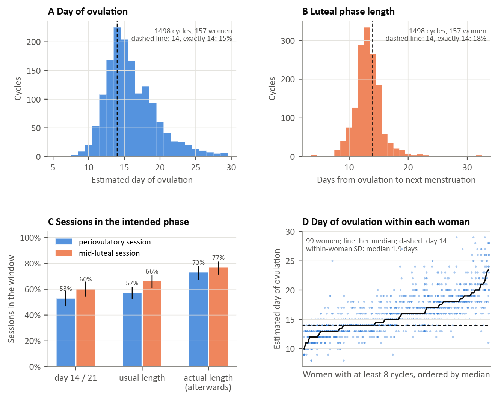

### Figure 1: Counting cycle days against the estimated day of ovulation (Marquette cycle data, 157 women)

The Marquette data come from a randomised comparison of two internet-supported fertility awareness methods. For each cycle the file gives its length and an estimated day of ovulation, derived from the fertility signs each woman recorded: a urinary hormone monitor in one study arm and cervical mucus in the other. 1498 cycles of 157 women had an estimated ovulation day consistent with the cycle and luteal lengths (median 10 cycles per woman).

(a) Estimated day of ovulation. (b) Luteal phase length, from ovulation to the next menstruation. (c) Share of sessions that fall in the intended window under three counting rules, on the 1198 cycles (132 women) with at least two previous cycles. (d) Day of ovulation in every cycle of the 99 women with at least 8 cycles.

| | Median (IQR) | 5th to 95th percentile | Share between women (ICC) | SD within a woman |
|---|---|---|---|---|
| Day of ovulation | 15 (14 to 18) | 11 to 23 | 0.64 | 2.2 days |
| Luteal phase length | 13 (12 to 14) | 10 to 17 | 0.48 | 1.9 days |
| Cycle length | 28 (27 to 31) | 25 to 37 | 0.52 | 2.6 days |

A periovulatory session is scheduled on the counted day of ovulation and counts as a hit 2 days before to 1 day after the estimated ovulation; a mid-luteal session is scheduled 7 days later and counts as a hit 5 to 9 days after it. Confidence intervals come from a bootstrap over women.

| Rule for the day of ovulation | Within 2 days of the estimate | Periovulatory session in window | Mid-luteal session in window | Women needed, relative to a perfect schedule |
|---|---|---|---|---|
| Day 14 (mid-luteal on day 21) | 60% | 53% (47 to 58) | 60% (54 to 66) | 2.8 times |
| 14 days before the menstruation expected from the previous cycles | 66% | 57% (52 to 62) | 66% (61 to 71) | 2.3 times |
| 14 days before the actual next menstruation (known afterwards) | 77% | 73% (67 to 78) | 77% (71 to 82) | 1.7 times |

- Ovulation fell on day 14 in 15% of cycles and on days 12 to 16 in 58%. The luteal phase lasted exactly 14 days in 18% of cycles and 12 to 16 days in 76%.
- Day 14 came on average 1.8 days before the estimated ovulation. The two backward rules were on average 0.6 to 0.7 days early.
- The day of ovulation was partly a property of the woman (ICC 0.64), but it still moved between her own cycles (median SD 1.9 days in women with at least 8 cycles), so a woman's history narrows the estimate without fixing it.
- The order of the rules was the same in both study arms: on day 21, 61% and 59%; with the usual cycle length, 65% and 67%; with the actual length, 81% and 71%.

The last column of the table assumes a within-woman comparison between an early follicular session (cycle days 2 to 5, which counting from menstruation places correctly) and a mid-luteal session, with an outcome that changes only inside the mid-luteal window. The expected difference then shrinks by the hit rate h and the number of women needed grows by 1/h². The assumption is deliberately simple. For an outcome that changes throughout the luteal phase the factors are too high, since a session one or two days outside the window still catches part of the change; for an outcome confined to a narrower window they are too low.

The estimated day of ovulation is itself an estimate from home-recorded signs, not from ultrasound or serum progesterone. Its error adds to the error of every rule, so these rates describe agreement with the best marker in the data rather than with the true day of ovulation.
