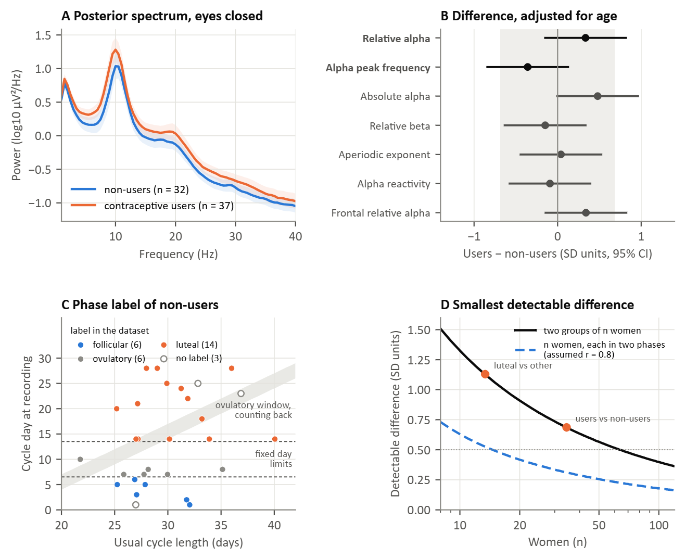

### Figure 2: Resting EEG, hormonal contraception and self-reported cycle phase (OpenNeuro ds007615, 69 women)

ds007615 holds one session per woman: four minutes of 64-channel EEG with eyes closed, then four with eyes open, recorded in Oslo from 69 healthy women aged 19 to 40. A questionnaire gives contraceptive use (37 current users: 21 progestin-only, 16 combined; 32 non-users: 21 past and 11 never users), the usual cycle length and the self-reported cycle day at the recording. No hormone was measured.

Each recording was downsampled to 256 Hz, high-pass filtered at 1 Hz, re-referenced to the average of the good channels and cleaned of eye movements by regression on the electro-oculogram. Spectra are averages of 2 s epochs; a median of 116 of 120 epochs was kept per recording (minimum 71) and a median of 2.5 channels was marked bad (maximum 11). All measures use the posterior channels except frontal alpha. All 69 women had a clear alpha peak.

(a) Posterior spectrum with eyes closed, mean and 95% confidence band. (b) Users minus non-users for seven measures, adjusted for age, in units of the residual SD; the grey band marks differences smaller than the sample could detect with 80% power. (c) Cycle day and usual cycle length of the non-users, coloured by the dataset's phase label; dashed lines are the day limits of that label and the grey band is the ovulatory window when counting back from the next menstruation. (d) Smallest detectable difference against sample size.

**Contraceptive users against non-users**, adjusted for age (37 and 32 women; Holm correction over the seven measures):

| Measure | Non-users, mean | Users, mean | Difference in SD (95% CI) | p | p, corrected |
|---|---|---|---|---|---|
| Relative alpha, eyes closed (primary) | 0.534 | 0.589 | 0.33 (−0.15 to 0.82) | 0.17 | 0.86 |
| Alpha peak frequency (primary) | 10.51 Hz | 10.24 Hz | −0.36 (−0.84 to 0.13) | 0.14 | 0.86 |
| Absolute alpha (log10 µV²) | 1.56 | 1.78 | 0.48 (−0.00 to 0.96) | 0.05 | 0.36 |
| Relative beta | 0.169 | 0.156 | −0.15 (−0.63 to 0.33) | 0.54 | 1.00 |
| Aperiodic exponent | 1.30 | 1.32 | 0.04 (−0.44 to 0.52) | 0.87 | 1.00 |
| Alpha reactivity (log10 eyes closed over open) | 0.648 | 0.620 | −0.09 (−0.57 to 0.39) | 0.71 | 1.00 |
| Frontal relative alpha | 0.383 | 0.439 | 0.34 (−0.14 to 0.82) | 0.17 | 0.86 |

- No measure differed after correction. Users had more alpha power and a lower alpha peak frequency than non-users, by about a third to half an SD, with confidence intervals that include zero.
- Combined and progestin-only users went in the same direction (absolute alpha 0.63 and 0.38 SD against non-users; corrected p 0.33 and 1.00). Leaving out the four women with hormonal treatment for a medical condition changed the primary differences by less than 0.03 SD.

**Self-reported phase.** The dataset's phase label follows the cycle day alone: days 1 to 6 follicular, 7 to 12 ovulatory and 14 to 29 luteal, whatever the cycle length (cycle length among non-users: median 28 days, range 22 to 40). Its binary version groups the ovulatory days with the luteal days. Counting back from the usual cycle length (ovulation at length minus 14, ovulatory window 2 days before to 1 day after) gave the same label for 14 of the 26 non-users with both labels:

| Dataset label | Follicular, counting back | Ovulatory, counting back | Luteal, counting back |
|---|---|---|---|
| Follicular (6) | 6 | 0 | 0 |
| Ovulatory (6) | 5 | 0 | 1 |
| Luteal (14) | 2 | 4 | 8 |

Luteal against the other non-users, adjusted for age:

| Rule | Luteal / other | Relative alpha, SD (95% CI) | Alpha peak frequency, SD (95% CI) |
|---|---|---|---|
| Dataset label | 15 / 12 | −0.24 (−1.06 to 0.57) | 0.45 (−0.36 to 1.27) |
| Counting back | 10 / 19 | −0.71 (−1.54 to 0.11) | 0.24 (−0.59 to 1.06) |

**Detectable effect.** With 80% power at α = 0.05, the sample could detect 0.69 SD between users and non-users and 1.13 SD between luteal and other non-users. A difference of 0.5 SD needs about 64 women per group. The same 27 women recorded in two phases could detect 0.35 SD if the measure correlated at 0.8 between sessions; this correlation is assumed, not measured in this dataset.

The direction of the contraceptive differences (more alpha power, slower alpha peak) is the same in both preparations, but this sample cannot separate an effect of about 0.4 SD from no effect. The phase comparison is weaker still: the two counting rules disagree for almost half of the women, and the estimate for relative alpha moved from −0.24 to −0.71 SD with the rule. Measuring a cycle effect on resting EEG would need a within-woman design with confirmed phases.
