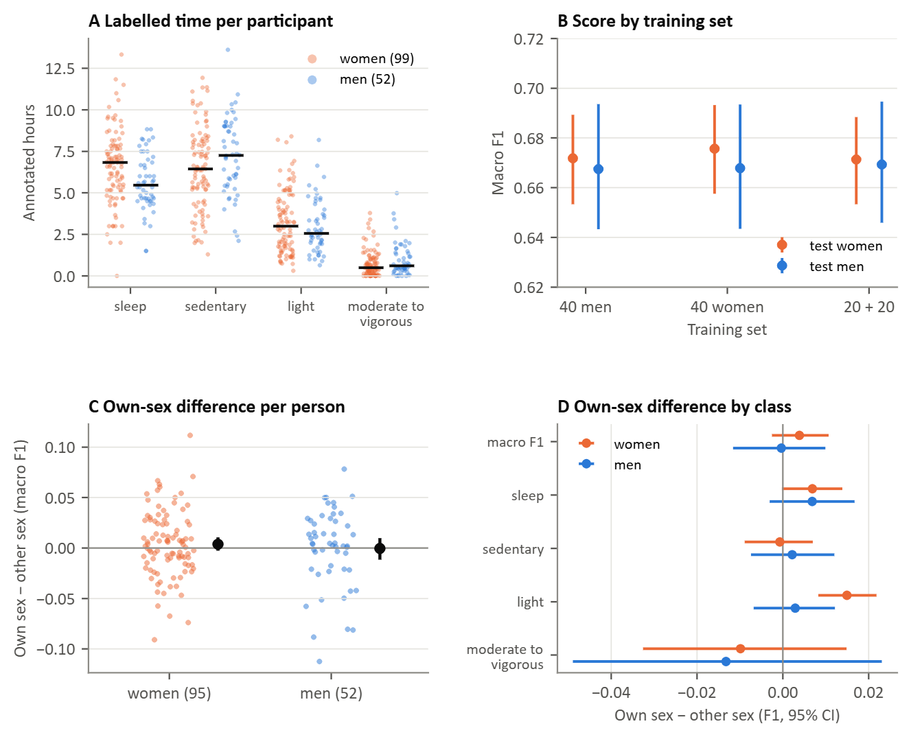

### Figure 3: Wrist activity recognition trained on men, women or both (CAPTURE-24, 99 women and 52 men)

In CAPTURE-24, 151 adults in the UK wore an accelerometer on the wrist for about 24 hours (100 Hz), with activities annotated from a wearable camera and a sleep diary. The signal was cut into 10 s windows labelled with four classes (sleep, sedentary, light, moderate to vigorous); a median of 6139 of 9390 windows per participant (68%) had a label. Each window has 32 features: magnitude statistics, axis means, spreads and correlations, wrist angles, and the spectrum and autocorrelation of the magnitude.

In each of 50 random splits, 12 men and 12 women of the same age bands were held out for testing. Three gradient-boosted tree classifiers were trained on 40 people each: 40 men, 40 women of the same age bands as those men, or 20 of each. Every test participant was scored on all labelled windows with the macro F1 over the classes that participant had. Scores were averaged within each person over the splits in which she or he was tested (median 6 splits for women, 12 for men; 95 of the 99 women were tested at least once), and confidence intervals come from a bootstrap over people.

(a) Annotated hours per participant in each class (lines: medians). (b) Macro F1 for test women and test men under each training set. (c) Own-sex difference in macro F1 for each person: the classifier trained on the person's own sex minus the one trained on the other sex. (d) Own-sex difference by class.

| Test participants | 40 men | 40 women | 20 + 20 |
|---|---|---|---|
| Women (95) | 0.672 (0.653 to 0.689) | 0.676 (0.658 to 0.693) | 0.671 (0.653 to 0.688) |
| Men (52) | 0.667 (0.643 to 0.694) | 0.668 (0.643 to 0.693) | 0.669 (0.646 to 0.695) |

Own-sex difference in F1 (95% CI; Wilcoxon signed-rank p):

| Score | Women | Men |
|---|---|---|
| Macro F1 | +0.004 (−0.003 to 0.011; p = 0.30) | −0.000 (−0.012 to 0.010; p = 0.43) |
| Sleep | +0.007 (−0.000 to 0.014; p = 0.05) | +0.007 (−0.003 to 0.017; p = 0.31) |
| Sedentary | −0.001 (−0.009 to 0.007; p = 0.80) | +0.002 (−0.007 to 0.012; p = 0.54) |
| Light | +0.015 (0.008 to 0.022; p < 0.001) | +0.003 (−0.007 to 0.012; p = 0.28) |
| Moderate to vigorous | −0.010 (−0.033 to 0.015; p = 0.45) | −0.013 (−0.049 to 0.023; p = 0.69) |

- The training set changed macro F1 by less than 0.01 for both sexes; the SD between people was 0.088. The mixed set did no better than the other-sex set (women −0.001, men +0.001).
- Light activity was recognised slightly better in women by a classifier trained on women (+0.015 F1). It is the only one of the ten differences in the table whose interval excludes zero. Women in CAPTURE-24 also recorded more light activity and sleep and less sedentary time than men (medians 3.0 against 2.6, 6.8 against 5.5 and 6.4 against 7.3 hours), so the classifier trained on women saw more light windows. The data cannot tell whether the gain comes from how women move or from that difference in time.

At the level of four broad intensity classes, a wrist classifier transferred between the sexes almost without loss. This says nothing about measures that depend on the form of a movement, such as gait events, tremor or fine motor control; testing those needs datasets that record them in both sexes.
