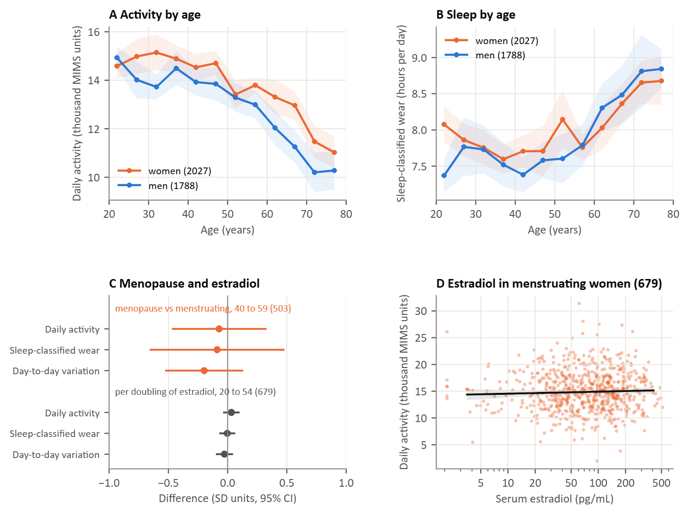

### Figure 4: Free-living activity and sleep by sex, menopause and estradiol (NHANES 2013–2014, 3815 adults)

In NHANES 2013–2014, participants of a nationally representative US survey wore an ActiGraph GT3X+ on the non-dominant wrist for up to 9 days. The daily summary file gives the activity sum in MIMS units and the minutes classified as wake wear, sleep wear and non-wear. Serum estradiol was measured once, at the examination; the reproductive health questionnaire records whether a woman had a period in the past 12 months and, if not, why; the prescription file records current hormone use. The day of the cycle was not recorded.

A day counted when it had 24 hours of data with at least 20 hours of wear; adults aged 20 to 79 with at least 4 such days and a body mass index were kept (2027 women, 1788 men, median 7 days). For each person: mean daily activity, mean daily sleep-classified wear time, and the day-to-day coefficient of variation of activity. All estimates use the examination weights; confidence intervals treat the 30 strata-by-PSU units of the survey as clusters.

(a) Daily activity and (b) sleep-classified wear time by sex and 5-year age band, weighted means with 95% confidence bands. (c) Differences in SD units, adjusted for age and body mass index: after menopause against menstruating, and per doubling of estradiol in menstruating women. (d) Estradiol and daily activity in menstruating women, with the adjusted regression line.

**Sex.** Adjusted for age, women recorded more activity than men (+0.80 thousand MIMS units a day, 95% CI 0.55 to 1.05; medians 13.9 and 12.9), slightly more sleep-classified wear (+0.12 hours, 0.00 to 0.24) and less day-to-day variation (−0.015, −0.022 to −0.007). Women were more active in every age band from 25 (by 0.1 to 1.7 thousand MIMS units), with the largest gaps at 30 to 34 and 60 to 74. Sleep-classified wear was higher in women up to age 54 and in men from 60.

**Menopause**, women aged 40 to 59 without hysterectomy, removal of both ovaries, pregnancy, breastfeeding or hormone use:

| Measure | Menopause (199, mean age 54) against menstruating (304, mean age 45), SD (95% CI) | Raw difference |
|---|---|---|
| Daily activity | −0.07 (−0.46 to 0.32) | −0.25 thousand MIMS units |
| Sleep-classified wear | −0.09 (−0.65 to 0.47) | −0.16 hours |
| Day-to-day variation | −0.20 (−0.52 to 0.12) | −0.019 |

**Estradiol**, 679 women aged 20 to 54 who had a period in the past 12 months, without pregnancy, breastfeeding or hormone use: median 77 pg/mL, 5th to 95th percentile 11 to 283 (25-fold), 1% below the detection limit. Women after menopause (from the table above) had a median of 6 pg/mL. Per doubling of estradiol, adjusted for age and body mass index:

| Measure | SD per doubling (95% CI) | p |
|---|---|---|
| Daily activity | 0.03 (−0.03 to 0.09) | 0.32 |
| Sleep-classified wear | −0.00 (−0.06 to 0.06) | 0.91 |
| Day-to-day variation | −0.03 (−0.09 to 0.04) | 0.42 |

MIMS units measure the volume of wrist movement, not locomotion. Tasks that move the arms more than the body, such as housework or care, may raise the wrist sum without more walking, which could explain part of the sex difference; these data cannot test it.

Neither menopause nor estradiol showed a clear association with daily activity or sleep. For menopause the intervals are wide and still include differences of about half an SD. For estradiol the upper limit of 0.09 SD per doubling corresponds to 0.43 SD between the 5th and the 95th percentile. An association within women across the cycle is not tested at all: a single sample on an unknown cycle day mixes differences between women with differences between phases.
